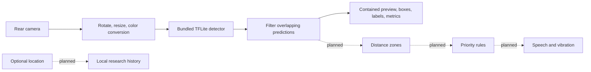

# Progress Presentation Outline

**Project:** Offline Android Assistive Navigation Research Prototype  
**Team:** Group 8 — [insert verified member names before presenting]  
**Status date:** 7 October 2026  
**Presentation rule:** Show the current detector as a supervised research test app. It is not a validated navigation aid. A missing box does not mean the path is clear.

## I. Project Overview

### System/Prototype Title & Team Members

**Working title:** Offline-First Mobile Assistive Navigation Prototype for Nearby Obstacle Awareness. **Team:** Group 8. The repository does not provide a verified complete member list; add names from the official roster.

### Problem Statement & Motivation

People with visual impairment may need timely information about nearby obstacles, direction, and urgency. A phone-based system could supplement an established mobility aid without requiring a cloud connection for its core warnings. Detection errors and delayed feedback can create risk, so this thesis treats safety and supervised evaluation as design constraints.

### Target Users and Stakeholders

- **Intended users:** People with visual impairment, subject to approved, supervised research.
- **Current users:** Researchers operating and evaluating the technical app.
- **Stakeholders:** Participants, mobility assistants, thesis advisers/panel, and institutions approving data collection and testing.

### High-Level System Goals

Capture a rear-camera view; recognize selected objects on-device; later estimate approximate warning zones, prioritize hazards, and provide speech and vibration cues. Optional location context and research history are later phases. The current build addresses camera detection and visual debugging only.

## II. Software Requirements

### Functional Requirements (current vs. planned)

| ID | Requirement | Status and evidence |
| --- | --- | --- |
| FR-01 | Start and stop an Android camera session | **Implemented** in `apps/mobile/lib/main.dart`; permission/model errors and app lifecycle stop are handled. |
| FR-02 | Detect selected objects offline and show labels, boxes, confidence, and approximate left/ahead/right position | **Implemented as a research display** using a bundled eight-class FP32 TFLite model. Accuracy and alignment are not validated for movement decisions. |
| FR-03 | Show technical session feedback | **Implemented:** frame count and processing time for sampled frames. This is not capture-to-warning latency. |
| FR-04 | Estimate approximate distance/warning zones | **Planned; not enabled.** Validate on controlled scenes before use. |
| FR-05 | Rank current hazards and suppress stale/repetitive alerts | **Planned; not enabled.** |
| FR-06 | Announce prioritized alerts and vibrate | **Planned; not enabled.** No spoken or haptic warnings in the app. |
| FR-07 | Provide optional location context, local history, and consent-based export | **Planned; not enabled.** No location permission, video recording, account, or backend in the current app. |

### Requirement Traceability (link to thesis objectives)

| Thesis objective | Related requirements | Current evidence / remaining proof |
| --- | --- | --- |
| 1. Offline-first architecture | FR-01–FR-07 | Local camera and bundled inference exist; full warning architecture remains a design. |
| 2. Flutter camera and on-device detection | FR-01–FR-03 | Flutter source, model metadata, app tests, and informal phone observation. |
| 3. Distance zones | FR-04 | Controlled calibration and held-out zone evaluation pending. |
| 4. Priority engine | FR-05 | Implementation and scripted multi-object tests pending. |
| 5. Speech and vibration | FR-06 | Integration, accessibility, and feedback validation pending. |
| 6. Optional GPS and place context | FR-07 | Consent design and implementation pending. |
| 7. Technical and usability evaluation | All | Public-data reports exist; independent campus and participant studies pending. |

Objective wording follows the [current manuscript](../04_Manuscript/Assistive_Navigation_Thesis_Ch1_Ch3.md). The table links each requirement upward to a study objective, consistent with [ISO/IEC/IEEE 29148's traceability definition](https://www.iso.org/obp/ui?_escaped_fragment_=iso%3Astd%3Aiso-iec-ieee%3A29148%3Aed-2%3Av1%3Aen).

## III. System Design & Architecture

### Overall Architecture

The **implemented** system is a single-device, layered Android app. It has no client-server communication. The proposed later architecture adds feedback, location, and local research logging only after their respective tests.

### Design Models

**Use cases / user stories:** A researcher starts a session, observes visual detections and technical status, then stops the session. The app handles permission denial and pauses camera use when it leaves the foreground. A future participant would receive a prioritized cue while a researcher supervises; this is a planned story, not a demonstrated feature.

**Data models:** The current app processes camera frames in memory and uses model metadata containing class order and checksum. No persistent user database, ERD, or account schema exists. A later local schema may hold consent, session timestamps, approximate location, and selected warning events; define retention and deletion before building it.

**System/module view:** `main.dart` manages session UI, camera lifecycle, and sampling; `detector.dart` loads the model and runs inference; `detection_overlay.dart` renders mapped boxes. Python scripts under `ml/` prepare data, train, evaluate, and export the model. This is a source-code module map, not a claim of deployed services.

### Technology Stack Selection

| Tool | Reason for selection / present boundary |
| --- | --- |
| Flutter/Dart | One Android research UI, camera controls, and reusable widget tests. |
| `camera` plugin | Access to rear-camera preview and image stream. |
| `tflite_flutter` | On-device inference with a bundled FP32 model; speed on the target phone still needs measurement. |
| Python, Jupyter, Ultralytics YOLOv8n | Reproducible dataset preparation and compact detector experiments. |
| ONNX and TensorFlow Lite export | Desktop-to-phone model path, with a recorded ten-image raw-output parity check. |
| Kotlin CameraX/LiteRT | **Contingency in the product plan**, if the current Flutter path misses the phone latency/stability gate; not the implemented camera pipeline. |

## IV. Current Prototype Progress

### Implemented Features (with screenshots or demo)

The app runs a contained camera preview with eight-class boxes: person, chair, stairs, car, bicycle, electrical pole, plant pot, and motorcycle. It shows confidence, rough direction, frame count, and sampled-frame processing time. The [app guide](../../apps/mobile/README.md) records an informal Infinix Note 40 (X6853) check. That check is not a scored phone study.

**Suggested demonstration:** show the idle screen; start the camera; show a class label and box; point out the frame metrics; stop the session; explain what happens when camera permission is denied. Use the [eight-image gallery](../../qa/phone_test_gallery/index.html) only as a visual demonstration because its images are from the reused public test split. Use a newly captured, consent-appropriate screenshot of the actual app for slides; do not label the [older full-screen proposal](../05_Product/mockups/navigation_fullscreen_proposal.png) as the implemented UI.

### System Flow Demonstration

Start → obtain rear camera and load model → sample at most one frame each 500 ms, dropping frames while busy → preprocess → infer → filter/map boxes → draw overlay and metrics → Stop releases the camera. Moving the app out of the foreground also stops the session.

### Code Quality & Documentation Practices

The Flutter source separates camera/session handling, inference, and overlay drawing. `apps/mobile/test/` contains widget and box-transform tests; `analysis_options.yaml` uses Flutter lints. The app and model have README/metadata documentation. Dataset policies, model reports, and export/parity records live under `ml/` and `runs/`.

**Version control:** This workspace has no usable local Git checkout/commit history in the available evidence. Do not present Git branching, pull requests, or CI as applied practices. Versioned experiment files and reports currently document model history.

## V. Software Engineering Practices Applied

### Development Methodology

The [manuscript](../04_Manuscript/Assistive_Navigation_Thesis_Ch1_Ch3.md) specifies iterative prototyping informed by the Spiral Model: plan, assess risks, build, and evaluate in cycles. The visible sequence is detector pilot → public-data revisions → model comparison/retrain → mobile export → Flutter technical app. This is evidence of iterations; a formal Scrum process is not documented.

### Task Management & Team Workflow

The [team guide](../../TEAM_START_HERE.md), [product plan](../05_Product/Assistive_Navigation_PRD.md), dataset policies, and versioned status reports provide a shared record. The repository does not establish task-board use, sprint cadence, individual ownership, or review approvals, so add those only if the team can show them.

### Testing Approach and Initial Results

| Level | Evidence now | Next validation |
| --- | --- | --- |
| Unit/widget | Box-coordinate transform tests and idle-screen widget tests are present. The team guide records prior local analysis, tests, and debug APK build. | Re-run checks for the presentation build and add detector postprocessing/error tests where needed. |
| Model/export | Ten public images passed a desktop ONNX-to-TFLite raw-output parity check. Public-data diagnostics expose class-specific misses. | Independent-source/campus testing, label review, and detection-level phone parity. |
| Integration/device | Informal X6853 camera/gallery observation only. | Record box alignment, p50/p95 capture-to-feedback latency once alerts exist, 20-minute stability, battery/thermal behavior, and accessibility. |
| Usability | No approved participant study result recorded. | Obtain ethics approval and use a supervised protocol; report participants and limitations accurately. |

Flutter distinguishes [unit, widget, and integration tests](https://docs.flutter.dev/testing/overview). Present the current checks at their actual level; a widget test does not establish real-device camera behavior.

### Configuration Management

`apps/mobile/` holds the app; `ml/` the model workflow; `data/` datasets; `runs/` experiment artifacts; `docs/` thesis and product documents; `qa/` demonstration material. The app bundles model weights plus class/checksum metadata. Setup is `cd apps/mobile`, `flutter pub get`, `flutter run` on a connected Android phone. No app CI/CD pipeline or public deployment is evidenced.

## VI. Challenges & Risks

| Challenge or risk | Evidence / impact | Mitigation |
| --- | --- | --- |
| Missed or mislabeled objects | Public-test person and small-bicycle misses; incomplete labels. | Complete human label audits, compare baselines, use independent held-out scenes, publish per-class failures. |
| Phone timing and box alignment | No systematic device latency, thermal, or alignment study. | Profile the actual phone and test rotation, color, letterboxing, and overlays; change runtime only if measured gates fail. |
| Distance and alert safety | Neither zones nor alerts are implemented or validated. | Keep them disabled until controlled gates pass; test with a supervisor and existing mobility aid. |
| Timeline and data access | Campus capture and participant evaluation need permission and logistics. | Sequence work by evidence gates; use clearly labeled technical evaluation if recruitment is unavailable. |
| Rights and privacy | Public source-image rights and model licensing remain under review; future location/history may expose sensitive data. | Resolve rights before distribution; collect only consented, necessary data and define deletion. |

## VII. Next Development Steps

1. Complete the person/stair/bicycle label review and independent-source or campus test design; freeze a candidate model and report per-class failures.
2. Measure physical-phone rotation/box accuracy, stability, speed, and thermal behavior before enabling user-facing warnings.
3. Implement and validate approximate distance zones on controlled, separate calibration and test scenes.
4. Add priority rules, stale-frame handling, speech, vibration, Stop behavior, and TalkBack checks after the preceding gates.
5. Add optional location/history only with consent, local retention/deletion rules, and proof that denied network/location access does not affect camera detection.

**Engineering enhancements:** keep preprocessing, inference, display, and future alert logic modular; add focused automated tests and a reproducible build record. For privacy, request only needed permissions and avoid raw-frame recording by default, in line with [OWASP mobile security guidance](https://cheatsheetseries.owasp.org/cheatsheets/Mobile_Application_Security_Cheat_Sheet.html). **Deployment:** distribute only a controlled research build after device and ethics checks; public release requires separate licensing, safety, accessibility, and broader device review.

## VIII. Timeline & Roadmap

### Milestones Achieved So Far

By early October 2026: desktop detector pilot; public-data revisions and eight-class model comparison; candidate export and limited desktop parity; Flutter camera/overlay build; informal target-phone check; initial unit/widget tests and documentation.

### Remaining Milestones (September to November)

The requested window begins before this status date. September is shown as **completed background work**, while October–November are **proposed targets**, not commitments or achieved results.

| Period | Milestone / evidence gate |
| --- | --- |
| September 2026 (past) | Public-data/model iteration and prototype preparation; verify exact dates from the team's records before claiming completion by month. |
| October 2026 | Finish label and source audit; collect permitted independent/campus scenes; measure phone geometry, latency, and stability. |
| Early November 2026 | Decide whether distance zones meet held-out thresholds; implement only supported cues and test priority/feedback. |
| Late November 2026 | Accessibility review, supervised evaluation if approved, results write-up, and a documented scope decision for the final prototype. |

## IX. Conclusion

### Summary of Prototype Status

The team has a working **detection-only research app** and a documented model workflow. It can show selected objects on a phone, but it cannot yet estimate proximity, warn through speech/vibration, or establish safe navigation performance.

### Key Learnings

Model export and live boxes are feasible, while label quality, class-specific misses, camera geometry, and phone timing determine whether a detection can become a useful warning. Product claims should follow the evidence for each stage.

### Call for Feedback / Guidance

“We welcome suggestions to improve design and engineering practices, especially our test gates, accessible feedback plan, and supervised evaluation.”
