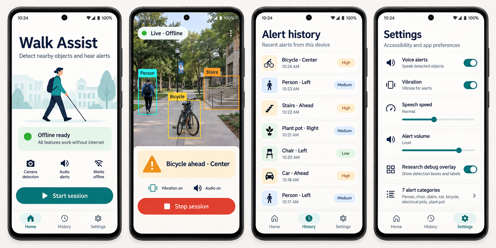
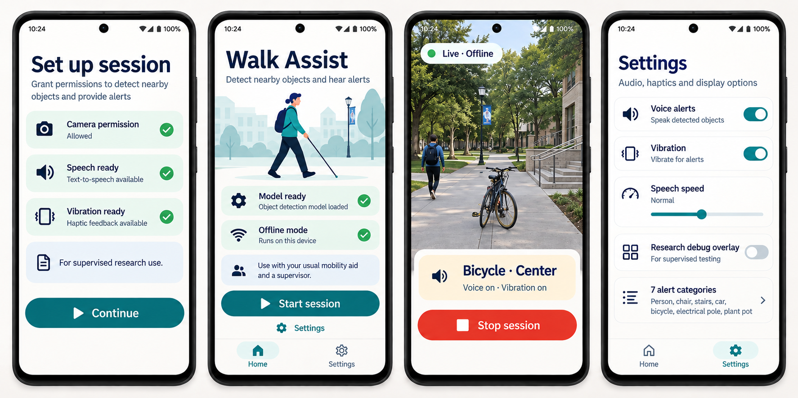

# Walk Assist Flutter UI concepts

## Complete product vision (preferred visual reference)

The team should use [v1](walk_assist_flutter_concept_v1.png) as the **desired complete visual direction**: Home, Live Session, Alert History, and Settings. It shows the intended look and feel, not a screenshot of working features. The history tab, High/Medium/Low chips, and visible detector boxes represent future or researcher-facing capabilities; implement them only after the relevant PRD gates. Keep the debug overlay off for ordinary users.

## First-build reference

This image is a **visual direction**, not a screenshot of a working app or a validated navigation aid. It covers the first detection-only technical app flow: setup, ready, live session, and settings. Build from the [product requirements](../Assistive_Navigation_PRD.md), using Material 3 with large touch targets, strong contrast, readable text, and TalkBack labels. The repository currently has **no Flutter app**; the planned implementation belongs under `apps/mobile/`.

## Screen behavior

| Screen | Core UI | Required behavior |
| --- | --- | --- |
| Setup | Camera permission, speech and vibration readiness, Continue | Show permission denial and unavailable feedback states; never display green checkmarks unless the device checks pass. |
| Ready | Model/offline status, Start session | Start only when camera permission and bundled model are ready; explain errors in text and speech. |
| Live Session | Camera preview, current class-and-direction alert, audio/vibration indicators, Stop | Keep the alert readable without the preview; stale frames, permission loss, pause, Stop, or model failure clear the active warning. Detection boxes are for research/debug only and default off. |
| Settings | Voice, vibration, speech speed, volume, debug overlay, categories | Persist locally. Seven app alert categories are person, chair, stairs, car, bicycle, electrical pole, and plant pot. Motorcycle is an eighth **training-only** discriminator until product scope is explicitly revised. |

Use neutral wording for uncertain detections. A frame with no detection means **unknown**, not a safe path. Do not show precise distance or danger tiers until proximity calibration and alert prioritization pass the PRD gates. The live screen's alert card is a design example, not proof that the current model reliably detects small bicycles: the latest public-data diagnostic matched 11/48 small bicycle boxes. The app still needs validation on the Infinix X6853. Alert history and local export belong to a later optional phase, so they are intentionally absent from this first-build concept.

Suggested Flutter structure: `SetupScreen`, `HomeScreen`, `SessionScreen`, `SettingsScreen`, plus reusable `StatusBadge`, `AlertCard`, `AccessiblePrimaryButton`, and `DetectionOverlay` (research-only). Keep camera analysis, model inference, and alert timing in the native Android module described in the PRD; Flutter renders session state and controls. The concept is silent on error screens; the team must implement model missing, camera denied, speech unavailable, pause, and stale-frame states from the PRD.

The v1 board remains the preferred complete-vision reference. The v2 board is a phase-specific implementation reference: it omits the later history and severity features, keeps the research overlay off, and shows the primary live view without detector boxes. Do not treat the v1 mockup as proof that the current model or app already supports those features.

Image-generation mode: built-in `image_gen`, use case `ui-mockup`. Final prompt summary: four consistent Android phone mockups showing setup/permission readiness, model-ready home, clean live class-and-direction alert without default detector boxes, and accessible settings with researcher overlay off; Material 3 styling, large text, teal primary and amber accent, seven app alert categories, no safety or proximity claim.
